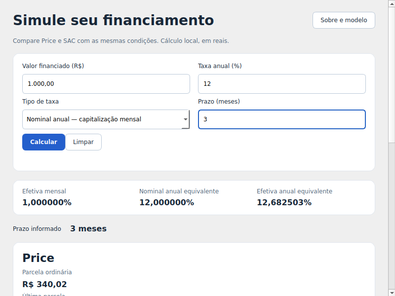

# CESEB — calculadora de financiamento

Aplicativo desktop em **C++20 e Qt 6 Widgets**, para Windows e Linux, com interface em português e valores em reais. Compara **Price e SAC** com taxa anual **nominal ou efetiva**, mostra prestações, totais, juros e taxas equivalentes. O cálculo ocorre localmente, sem conta ou serviço remoto.

O aplicativo está implementado. Os cálculos usam dinheiro em centavos e comparações numéricas exatas para os arredondamentos definidos no projeto. Os arquivos próprios usam a [licença MIT](LICENSE); dependências têm termos próprios em [THIRD_PARTY_NOTICES.md](THIRD_PARTY_NOTICES.md).

## Usar e compilar

- [Guia do usuário](docs/user-guide.md): entradas, exemplos, atalhos, ajuda e convenções financeiras.
- [Build, testes e pacotes](docs/build-and-test.md): dependências fixadas, núcleo isolado, aplicação e entrega Windows/Linux.
- [Documentação e relatório técnico](docs/README.md).

No Windows, extraia o ZIP completo e abra `bin/ceseb.exe`. No Ubuntu, instale o DEB e abra o lançador CESEB. Preserve as bibliotecas privadas, plugins e licenças que acompanham cada pacote. Os pacotes são gerados localmente; este repositório ainda não publica uma release para download.

## Validação observada

O mesmo código foi compilado e testado em Linux e Windows: **26/26 testes por backend**, além da configuração isolada de núcleo. A rodada de validação adicional usou **Ubuntu 24.04.5/GCC 13.3 em contêineres Docker**, executando **21/21 testes do núcleo sem Qt instalado**, e o aplicativo real instalado pelo DEB em ambiente sem ferramentas de desenvolvimento. No Windows 11, o consumidor isolado do núcleo passou **20/20 casos**, sem Qt nas dependências ou nos módulos carregados.

O uso real do aplicativo no Ubuntu 24.04, em sessão X11 com Xvfb/Openbox, cobriu preenchimento por teclado, nominal/efetiva, cálculo, erro e correção, limpeza, ajuda offline, abertura da pasta de licenças e janela de 800×600 pixels lógicos nas escalas de 100% e 200%. A interação Windows está preparada e aguarda o desbloqueio da sessão do usuário. Abertura técnica do pacote Windows foi observada.

O inventário atual é **20 requisitos aprovados, dois reprovados (1225 e 1228) e três protocolos Windows interrompidos pelo bloqueio da sessão (1215, 1216 e 1226)**.

Há uma falha conhecida de empacotamento: o ZIP Windows inclui `dxcompiler.dll` e `dxil.dll` sem avisos específicos recuperáveis nos materiais entregues. O requisito de avisos e o critério correspondente do pacote estão reprovados enquanto isso permanecer. A presença do ZIP e os testes de cálculo não eliminam essa falha.

Captura real da aplicação no Ubuntu 24.04, em 800×600 pixels lógicos; os resultados restantes ficam acessíveis por rolagem:

[Captura real a 200%, com quitação e resultados completos](docs/validation/r3/ubuntu24-200pct.png).

## Projeto e rastreabilidade

O projeto segue Mikoshi Design, com requisitos de produto separados das ferramentas e dos planos. Os corpos aprovados e o histórico das revisões são preservados; notas de pesquisa em draft continuam identificadas como draft.

- [Design aprovado e resolução numérica/Qt](.mikoshi/brain/sessions/1-mortgage-desktop/documents/1015/r3-research-driven-design.md).
- [Planos de testes e implementação e cobertura dos 25 requisitos](.mikoshi/brain/sessions/1-mortgage-desktop/documents/1033/r1-engineering-plan-review-index.md).
- [Resultados da Synapses 2](.mikoshi/brain/sessions/1-mortgage-desktop/evidence/synapses/r2/round.md).
- [Validação adicional e publicação da branch](.mikoshi/brain/sessions/1-mortgage-desktop/evidence/synapses/r3/round.md).
- [Pedido humano original](.mikoshi/brain/sessions/1-mortgage-desktop/documents/1001/r1-human-request.md).

Os relatórios identificam o commit executado e distinguem resultados de produto, falhas e condições de ambiente. Capturas, ambientes e outputs operacionais completos podem permanecer locais; o repositório não afirma que o simples link para um relatório contém todos os seus outputs.

A simulação simplificada não inclui seguros, tarifas, impostos ou indexadores e não representa CET ou oferta de crédito.
