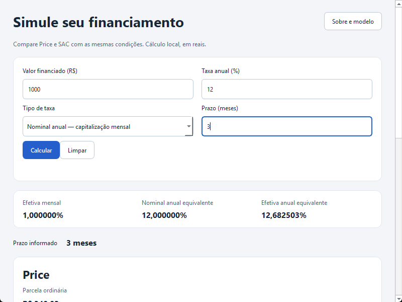

# Calculadora Financiamento

Aplicativo desktop para comparar **Price e SAC** com taxa anual **nominal ou efetiva**. Desenvolvido em C++20 e Qt Widgets, com interface em português e valores em reais. Os cálculos são locais, sem conta, servidor ou conexão durante o uso.

## Baixar e executar

**Não é necessário clonar o repositório, compilar o projeto ou instalar Qt e compiladores para usar o aplicativo.** Baixe o pacote da sua plataforma na [release v0.1.0](https://github.com/paulo-vitor-cs/ceseb/releases/tag/v0.1.0).

| Plataforma | Download | Como usar |
|---|---|---|
| Windows 11 · x64 | [ZIP portátil](https://github.com/paulo-vitor-cs/ceseb/releases/download/v0.1.0/calculadora-financiamento-0.1.0-windows-x86_64.zip) | Extraia o ZIP inteiro e abra `bin\ceseb.exe`. |
| Linux · Ubuntu 24.04 · x64 | [Pacote DEB](https://github.com/paulo-vitor-cs/ceseb/releases/download/v0.1.0/calculadora-financiamento_0.1.0_amd64.deb) | Instale pelo gerenciador de pacotes ou pelo comando abaixo. |

### Windows

1. Baixe o ZIP e extraia todo o conteúdo para uma pasta de sua escolha.
2. Abra a pasta `bin` e execute `ceseb.exe`.
3. Mantenha as DLLs, os plugins e as demais pastas que acompanham o programa.

O ZIP já contém as bibliotecas Qt e o runtime C++ necessários. Não é preciso instalar Visual Studio.

### Ubuntu 24.04

Na pasta em que o DEB foi baixado, execute:

```sh
sudo apt install ./calculadora-financiamento_0.1.0_amd64.deb
```

O gerenciador resolve as dependências de sistema. Depois, abra o aplicativo pelo menu ou execute:

```sh
/opt/ceseb/bin/ceseb
```

O pacote inclui Qt privado. Não é necessário configurar um SDK ou um ambiente de desenvolvimento. A distribuição Linux desta versão é destinada ao **Ubuntu 24.04 x86_64**.

Os [checksums SHA256](https://github.com/paulo-vitor-cs/ceseb/releases/download/v0.1.0/SHA256SUMS.txt) estão disponíveis junto aos downloads.

## Funcionalidades

- Comparação Price/SAC com o mesmo valor, taxa e prazo.
- Conversão entre taxa nominal anual, efetiva anual e efetiva mensal.
- Exibição de prestações, pagamento final, juros, totais e quantidade efetiva de pagamentos.
- Validação em formato brasileiro, recuperação de erros e invalidação de resultados após editar a entrada.
- Operação por teclado, redimensionamento e ajuda offline.
- Dinheiro em centavos inteiros e política de arredondamento half-up explícita.



### Exemplo

Informe **R$ 1.000,00**, taxa anual **nominal de 12%** e prazo de **3 meses**:

| Resultado | Price | SAC |
|---|---|---|
| Parcela ordinária / primeira | R$ 340,02 | R$ 343,34 |
| Última prestação | R$ 340,03 | R$ 336,66 |
| Total pago | R$ 1.020,07 | R$ 1.020,00 |
| Juros totais | R$ 20,07 | R$ 20,00 |

## Documentação do projeto

O trabalho apresenta a relação do **Modelo V** entre especificações, requisitos, arquitetura, implementação e testes de unidade, integração e sistema.

| Documento | Conteúdo | Download |
|---|---|---|
| Relatório técnico · 9 páginas | Especificações, 25 requisitos com critérios de aceite, decisões, tecnologias e validação. | [PDF](https://github.com/paulo-vitor-cs/ceseb/releases/download/v0.1.0/relatorio-do-projeto.pdf) |
| Apresentação · 10 slides | Visão do projeto, diagramas e exemplos de testes por nível, com notas do apresentador. | [HTML](https://github.com/paulo-vitor-cs/ceseb/releases/download/v0.1.0/apresentacao-do-projeto.html) |

Baixe o HTML e abra-o no navegador. Ele funciona offline, com navegação por setas, sumário, notas e tela cheia. Para abrir o PDF pelo link da apresentação, mantenha os dois documentos na mesma pasta.

Os documentos também estão versionados em [`docs/`](docs/README.md): [relatório PDF](docs/relatorio-do-projeto.pdf) e [apresentação HTML](docs/apresentacao-do-projeto.html).

- [Guia do usuário](docs/user-guide.md).
- [Dependências, compilação e testes](docs/build-and-test.md), para quem deseja desenvolver ou compilar.

## Tecnologias e validação

**C++20**, **Boost 1.86.0**, **Qt 6.12.0 Widgets/Fusion**, **Google Test 1.17.0**, **Qt Test**, **CMake**, **CTest** e **Ninja**. Compilação com MSVC 2022/v143 no Windows e GCC 13 no Ubuntu 24.04.

Os testes relacionam entradas e resultados esperados aos critérios dos requisitos. Incluem conversão de taxas, centavos e quitação, integração de entrada e estado da interface e operação dos pacotes. A suíte com interface concluiu 27 verificações e o núcleo isolado 21 por plataforma, sem falhas. Os conjuntos compartilham casos de domínio. O uso do aplicativo foi exercitado em 100% e 200% no Windows e em Ubuntu 24.04 com desktop X11 no WSL.

## Licença e limites

Os arquivos originais usam a [licença MIT](LICENSE). As dependências conservam seus próprios termos, disponíveis em [THIRD_PARTY_NOTICES.md](THIRD_PARTY_NOTICES.md) e nos materiais de licença dos pacotes.

A simulação considera prestações mensais, taxa fixa e as convenções documentadas. Não inclui seguros, tarifas, impostos ou indexadores e não representa CET ou oferta de crédito. Simulações não são salvas entre execuções.
